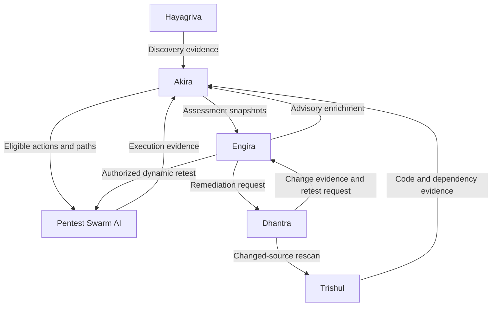

# Hayagriva

**Reusable reconnaissance & application discovery for the Armur suite — a Go library and CLI.**

> **Status: scaffold.** This repository is initialized; the implementation
> described below is **planned**, not yet built. Nothing here claims a working
> feature until its own package/docs say "implemented". Written in **Go**.

Hayagriva is the discovery engine of the Armur product suite. It performs
reconnaissance and application discovery, collects and parses evidence from a
target's exposed surface, and emits **structured, attributable discovery
evidence** that downstream products consume. It is useful standalone (point it
at a target, get a parsed inventory) and embeddable as a Go library.

## Role in the Armur suite

Hayagriva produces discovery evidence; other products reason over it. It is one
of six independent, interoperable products.



Hayagriva does **not** attack, score, or report — it discovers and parses. That
separation is deliberate: recon ownership lives here (formerly split across
other tools), so there is exactly one authoritative discovery producer.

## What it will do (planned)

- **Reconnaissance** — resolve a target scope into hosts, services, endpoints,
  and application surface. Passive and active modes, scope-bounded.
- **Application discovery** — enumerate routes, parameters, forms, APIs
  (OpenAPI/GraphQL introspection where available), auth surfaces, and object
  references.
- **Collection** — capture raw evidence (responses, headers, fingerprints) with
  provenance (what was seen, when, how).
- **Parsing** — normalize tool output (nmap, httpx, katana, nuclei, and
  Hayagriva-native probes) into one typed evidence model.
- **Reusable Go library** — `pkg/` exposes the engine; the CLI and any API
  adapter are thin consumers of it, never of each other's internals.

## Design principles

- **Evidence, with provenance.** Every discovered item carries how/when it was
  observed. Downstream trust depends on it.
- **Scope-bounded and safe.** Discovery honors an explicit scope; no traffic
  outside it. Active probing is opt-in and rate-limited.
- **Standalone first.** A useful recon workflow must not require any other Armur
  service running.
- **One engine, many adapters.** File/CLI, in-process Go, and optional
  authenticated HTTP adapters implement the same declared semantics.

## Install (planned)

```bash
go install github.com/Armur-Ai/Hayagriva/cmd/hayagriva@latest
```

Module path: `github.com/Armur-Ai/Hayagriva`.

## Usage (planned)

```bash
# Discover an application surface within an explicit scope
hayagriva discover https://target.example --scope target.example --out recon.json

# Use as a library
#   import "github.com/Armur-Ai/Hayagriva/pkg/discovery"
```

## Status & roadmap

This is a fresh scaffold. See [ROADMAP.md](./ROADMAP.md) for the phased plan.

## License

See `LICENSE` (to be added).
